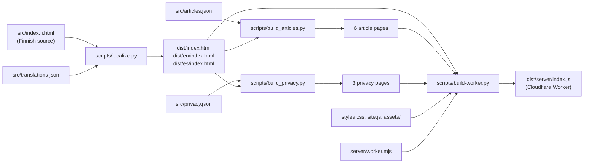

# Migration report: ChatGPT Sites prototype → Next.js

This report documents the technical migration of the Oulasvirta Consulting website from the
ChatGPT Sites prototype (`oulasvirta-consulting-v10.zip`) to a Next.js application that is
maintained in this repository and deployed to Vercel from GitHub Actions.

It is written so that a developer or a coding agent who was not part of the migration can
understand what was found, what was decided and why, what changed, and what still needs a
human.

> **Status of this document.** Sections 1–8 (analysis) were written and committed *before*
> any structural change was made to the package. Sections 9 onwards record the migration
> outcome and are added as the work progresses.

## 1. Summary

| Question | Answer |
| --- | --- |
| What was supplied? | A ZIP with a Python-generated static site: one Finnish HTML source, a JSON translation dictionary, three build scripts, hand-written CSS/JS and photographs. |
| Was there Git history? | **No.** The ZIP has no `.git` directory and no `versionhistoria.bundle` or any other Git bundle. There was nothing to preserve or import. The package was committed unchanged as the first commit of this migration (see §2). |
| Is the ZIP the newest version? | **Yes, as of 30 September 2026.** All 12 HTML pages, the stylesheet, the script and all images of the published ChatGPT site match the ZIP; the only difference is one script injected by the hosting layer (details in §6). |
| Biggest risk found | Every page contains `<meta name="robots" content="noindex, nofollow">`. Shipping the prototype as-is would have removed the company from search engines. |
| Second biggest risk | The current WordPress site has 12 indexed URLs (`/palvelut/…`, `/meista/`, `/2024/08/14/…`). None of them exist in the prototype, so a domain switch without redirects would turn all of them into 404 errors (§7). |
| Contact form | Native HTML `POST` to the free third-party service FormSubmit. It works without any server code, but needs one-time mailbox activation after the domain changes (§4.8). |

## 2. Supplied package

The ZIP unpacks to a single folder, `oulasvirta-consulting-v10/`, with 36 files. It was
committed unchanged under `legacy/chatgpt-site-v10/` (commit *“chore: import ChatGPT Sites
prototype v10 unchanged (baseline)”*) so that every migration step can be reviewed as a diff
against the original. Three files were deliberately **not** imported:

| Not imported | Why |
| --- | --- |
| `dist/server/index.js` (1.8 MB) | Generated Cloudflare Worker bundle with every asset embedded as base64. A build artifact; it can be rebuilt from `server/worker.mjs` and `scripts/build-worker.py`. |
| `dist/assets/koulutus-lahitapiola.jpg` | Not referenced by any page. It is a personal photo that shows a client visitor badge, and this repository is public. It was removed from the pages in an earlier iteration of the prototype (stale translation keys still refer to it). It is still served publicly by the ChatGPT site if someone knows the URL. |
| `.openai/hosting.json` | ChatGPT Sites hosting metadata. Meaningless outside that platform. |

### Inventory

| Path | Size | Role | Source or generated? |
| --- | ---: | --- | --- |
| `src/index.fi.html` | 36 KB | The entire Finnish home page as one HTML file (150 lines) | **Source** |
| `src/translations.json` | 77 KB | Dictionary: Finnish sentence → `[English, Spanish]`. 317 keys, of which only 276 are still used | **Source** |
| `src/articles.json` | 18 KB | Two archived articles, three languages, as typed blocks | **Source** |
| `src/privacy.json` | 10 KB | Privacy notice in three languages (some strings contain raw HTML) | **Source** |
| `src/training-sources.json` | 2 KB | Provenance notes for the training photographs. Not read by any script | Documentation |
| `scripts/localize.py` | 7 KB | Builds `dist/index.html`, `dist/en/`, `dist/es/` by rewriting the Finnish HTML text node by text node | Build script |
| `scripts/build_articles.py` | 5 KB | Renders article pages by slicing the home page HTML with `split()`/`re.sub` | Build script |
| `scripts/build_privacy.py` | 3 KB | Same technique for the privacy pages | Build script |
| `scripts/build-worker.py` + `server/worker.mjs` | 3 KB | Embeds every public file as base64 in a Cloudflare Worker | Build script / runtime |
| `dist/**/index.html` (12 documents) | 5–40 KB each | Generated pages: 3 home, 6 article, 3 privacy | **Generated** |
| `dist/styles.css` | 37 KB | The whole stylesheet. Lives in `dist/` but has no source copy | **Hand-written source stored in `dist/`** |
| `dist/site.js` | 4 KB | Menu toggle and contact-form behaviour. Same situation as the CSS | **Hand-written source stored in `dist/`** |
| `dist/assets/*` | 0.7 MB | Photographs, favicon, logo. Same situation | **Assets stored in `dist/`** |
| `CONTACT_SETUP.md` | 3 KB | Explains the contact-form design and its history | Documentation |

### Original architecture

The English and Spanish home pages are **not** separate sources. They are produced from the
Finnish HTML by looking up every text node in `translations.json` (the Finnish sentence is
the key). Article and privacy pages are produced by cutting the generated home page in two
at the strings `<main id="sisalto">` and `<footer`, and gluing a new `<main>` in between.

## 3. What the site consists of

One long single-page site with these sections, in DOM order:

| Section (anchor) | Content |
| --- | --- |
| Header | Wordmark, primary navigation (6 items), language switch FI/EN/ES, mobile menu button |
| Hero (`#alku`) | Headline, intro, call to action, “20+ years” proof point, portrait |
| Focus band | Two teaser links (EU AML reform, own-expert model) |
| Sectors (`#toimialat`) | Banks, export companies (with worked example), accounting/audit, property management, gambling |
| EU AML reform (`#eu-aml`) | Date panel (10 July 2027), three steps, expandable list of five EU/Finnish instruments |
| MLRO / own expert (`#mlro`) | Two engagement models, how the cooperation works, expandable role details |
| Services (`#palvelut`) | Four expandable services |
| Speaking and training (`#koulutukset`) | Four photo cards, two text events, call to action |
| About (`#katja`) | Biography and expertise panel |
| References (`#referenssit`) | Two references, one expandable client story |
| Writing (`#kirjoituksia`) | One external interview, two archived articles (own pages) |
| Contact (`#yhteys`, form `#yhteydenottolomake`) | Contact details and enquiry form |
| Footer | Legal entity, privacy link, back to top |

Additional pages: two archived articles and the privacy notice, each in three languages.
Public URL model of the prototype (kept): `/`, `/en/`, `/es/`,
`/kirjoituksia/<slug>/` (also under `/en/` and `/es/`), `/tietosuoja/`, `/en/privacy/`,
`/es/privacidad/`.

## 4. Findings

### 4.1 Version control

No history exists. The prototype lived only on the ChatGPT Sites platform. GitHub is now the
single source of truth.

### 4.2 Source versus generated files

* `dist/` mixes generated output (all HTML, the Worker bundle) with the *only* copies of
  hand-written CSS, JavaScript and images. Nothing that lives in `dist/` can safely be
  deleted and regenerated.
* All 12 HTML documents are committed build output derived from four JSON files and one HTML
  file.
* Generated content that should not be committed to Git: `dist/server/index.js`, the
  `dist/**/index.html` files and `__pycache__/`.

### 4.3 HTML structure, semantics and accessibility

Good and worth keeping:

* skip link (`Siirry sisältöön`) as first focusable element; landmarks `header`, `nav`
  (labelled), `main`, `footer`; exactly one `h1` per page and a logical h2/h3 outline;
* sections labelled with `aria-labelledby`; expandable content uses native
  `
/
` (no JavaScript, keyboard accessible);
* menu button with `aria-expanded` and `aria-controls`, closes on <kbd>Esc</kbd>, on link
  click and when the viewport grows;
* language links with `lang`, `hreflang` and `aria-current="page"`;
* visible focus outline on links, buttons, summaries and form controls;
  `prefers-reduced-motion` respected; `scroll-padding-top` for the sticky header;
* form: real `<label for>`, `autocomplete`, `maxlength`, `required`, hint linked with
  `aria-describedby`, a polite live region for status, a honeypot that is hidden from
  assistive technology, foreign-language quotes marked with `lang`;
* images have meaningful `alt` text and intrinsic `width`/`height`; only the hero image is
  eager (`fetchpriority="high"`), the others are `loading="lazy"`.

Gaps to fix during the migration (small, no visual effect):

* the decorative arrow `↗` is `aria-hidden` in some links but part of the link text in
  others, so screen readers announce “north east arrow” inconsistently;
* English text on Finnish and Spanish pages (EU regulation names such as
  “Anti-Money Laundering Regulation”) has no `lang="en"`;
* links that open a new tab do not say so to assistive technology;
* colour contrast has not been verified (measured in the verification section).

### 4.4 CSS

* One file, 37,642 bytes, **641 rules in 59 physical lines**, written as if minified; 123
  distinct classes; 18 `@media` blocks; three `!important`.
* Built by appending patches: several selectors are redeclared later in the file
  (`.contact-grid`, `.section-bottom`, `.mlro-intro h2`, `.header-inner`, …) and rely on
  source order to win. Reordering the file would silently change the design.
* Eight width breakpoints (max 365, 600, 820, 1050, 1100, 1150 and 1200 px; min 1500 px),
  several of which patch each other, plus `prefers-reduced-motion`.
* Four classes are never used by any page: `legal-updated`, `source-links`,
  `training-card--sijoitusakatemia`, `writing-disclosure`.
* Design tokens exist only partly (`--ink`, `--gold`, `--text`, …); many colours are
  repeated as literals.
* System font stack (`Georgia`, `Helvetica Neue`/`Arial`); **no web fonts are loaded**.

### 4.5 JavaScript (`dist/site.js`, 4 KB, no dependencies)

* Mobile menu toggle, <kbd>Esc</kbd> handling, close-on-navigation, close on resize.
* Contact form: fills hidden fields (`_subject` from the selected topic, `language`, `_url`,
  `_next`), keeps a `mailto:` fallback link in sync, preselects the topic when a call to
  action with `data-contact-topic` is clicked, checks the honeypot, shows a success message
  after the provider redirects back with `?contact=sent`.
* A workaround for the ChatGPT preview iframe (`window.self !== window.top` → open links and
  the form in a new tab). It is meaningless in production and is not carried over.

### 4.6 Assets

| File | Dimensions | Used? |
| --- | --- | --- |
| `katja.jpg` | 1400×933 | Hero portrait |
| `koulutus-kesapaivat-2026.jpg` | 1151×1536 | Training card |
| `koulutus-rahanpesupaiva-2025.jpg` | 1152×1536 | Training card |
| `koulutus-isannointiliitto.jpg` | 1152×1536 | Training card |
| `koulutus-juristiliitto-2025.jpg` | 1152×1536 | Training card |
| `favicon.png` | 192×192 | Icon |
| `brand.png` | 1024×564 | **Not referenced** (the gold logo; a good source for the social sharing image) |
| `koulutus-lahitapiola.jpg` | 864×2048 | **Not referenced** (not imported, see §2) |

Photographs are 130–230 KB JPEGs served at full size to every device.

### 4.7 Internationalisation

* Three languages (`fi`, `en`, `es`) produced at build time; no runtime translation.
* **Finnish sentences are the translation keys.** Correcting a typo in the Finnish HTML
  breaks the lookup until the same typo is corrected in `translations.json`.
* Text is translated per text node, so markup splits sentences (`Vaativa sääntely.` ` `
  `<em>Toimivat ratkaisut.</em>` are three keys).
* 41 of 317 keys (13 %) are stale, i.e. no longer used by any page. Some tell a story:
  `Kaupallinen yhteistyö: Netvisor KYC` (“Commercial collaboration: Netvisor KYC”) is an old
  disclosure line for the featured Kauppalehti interview, which is published under
  Kauppalehti's *partner content* section (`/kumppanisisallot/netvisor-kyc/`). The current
  prototype no longer shows that line and `.writing-disclosure` is an unused class.
  **It was not re-added; the owner should confirm that removing it was intentional**
  (see §12).
* The two testimonials are **verbatim quotes** on the Finnish page (Finnish and English
  originals, in `<blockquote lang>`) but **translated summaries** on the English and Spanish
  pages. This is a deliberate integrity choice (no invented quotations) and must be
  preserved.
* `<html lang>`, `hreflang` alternates and language links are correct but use relative URLs.
* The `<title>` and meta description are translated for all pages.

### 4.8 Contact form

* Native `<form method="post" action="https://formsubmit.co/katja@oulasvirta.com">`, with
  hidden fields `_subject`, `_template=table`, `_url`, `_next`, `language` and the honeypot
  `_honey`. FormSubmit shows its own reCAPTCHA step and redirects to `_next`.
* Documented history (`CONTACT_SETUP.md`): an earlier relay through a Worker was rejected by
  FormSubmit with HTTP 429 because reCAPTCHA had been disabled. It was removed. **It must not
  be reintroduced.**
* **External dependency:** FormSubmit (free service). It requires the mailbox owner to
  activate the form once, after the first accepted submission, and may require activation
  again when the domain changes. Submissions are retained for 30 days by the provider.
  The privacy notice already names FormSubmit.
* The recipient address is visible in the HTML (`action` URL). It is also shown on the page,
  so this is not a new exposure. FormSubmit offers an “invisible email” endpoint as an
  optional improvement, which only the owner can obtain.
* `_url` is not listed in FormSubmit's public documentation. It is kept for
  compatibility and is harmless.
* Defaults of `_url` / `_next` in the static HTML point at the `chatgpt.site` host and are
  only corrected by JavaScript. Without JavaScript the confirmation would have returned to
  the prototype host.

### 4.9 SEO

| Item | Prototype |
| --- | --- |
| `robots` meta | **`noindex, nofollow` on every page** |
| `robots.txt`, `sitemap.xml` | Missing (404) |
| Canonical URL | Missing |
| `hreflang` | Present (`fi`, `en`, `es`, `x-default`) but with relative URLs |
| Open Graph / Twitter cards | Missing |
| Structured data | Missing |
| Icons | One 192 px PNG, no Apple touch icon |
| Title / description | Present and translated |
| Caching | Worker sends `Cache-Control: no-cache` for every file, including images and CSS |

### 4.10 Security and privacy

* The Worker sets a strict CSP (`default-src 'self'`, `form-action 'self' https://formsubmit.co`),
  `nosniff` and a referrer policy. The only concession is `frame-ancestors https://chatgpt.com`,
  needed for the ChatGPT preview and not wanted in production. The Cloudflare bot-management
  snippet and a `__cf_bm` cookie that the live host adds are part of the hosting layer, not
  of the source.
* No secrets, tokens or credentials were found in the package. The recipient e-mail address
  and telephone number are business contact details that are printed on the site.
* The privacy notice states: no analytics or marketing cookies; FormSubmit as recipient
  service; 12-month retention. The migration must not add analytics or third-party fonts,
  and the notice should be re-read when the hosting provider changes (see §12).
* The public repository must not contain the unreferenced personal photo (not imported) or
  ChatGPT hosting metadata (not imported).

### 4.11 References to the previous WordPress site

* Only the two articles in `articles.json` refer to WordPress: each keeps its original
  address in a `source` field, e.g.
  `https://oulasvirtaconsulting.com/2024/09/11/tiedatko-kuka-yritykseesi-investoi/`.
* Nothing else in the package depends on WordPress (`CONTACT_SETUP.md` says the same).
* The live WordPress.com site is described in §7.

### 4.12 Obsolete or questionable files and content

* `dist/server/index.js`, `scripts/build-worker.py`, `server/worker.mjs`: hosting-specific,
  obsolete after the move to Vercel.
* `.openai/hosting.json`, `CONTACT_SETUP.md` (its content is folded into the new
  documentation), the Python scripts and the four JSON files (replaced by the typed content
  model).
* `src/training-sources.json`: useful provenance; the facts it records (event dates, source
  links, why a photo was removed) are preserved as comments in the content model.
* 41 stale translation keys; 4 unused CSS classes; 2 unreferenced images.

### 4.13 Technical debt, ranked

1. `noindex, nofollow` everywhere; no canonical/OG/sitemap/robots (business impact).
2. No redirects from WordPress URLs (business impact).
3. Generated and hand-written files are mixed; the only copies of CSS/JS/images live in
   `dist/`.
4. Translation keyed by Finnish sentences, with 13 % stale keys and markup-split strings.
5. HTML assembled by string slicing and regular expressions.
6. Build scripts that fail on Windows (`Path.read_text()` without `encoding="utf-8"` raises
   `UnicodeDecodeError` on the default code page; reproduced during the analysis).
7. Patch-layered, minified-style CSS that depends on rule order.
8. Preview-only code and constants (`chatgpt.site`, iframe workaround, frame-ancestors).
9. Full-size images for every device; no long-lived caching.
10. No automated checks of any kind.

## 5. Ownership

* Business owner and content owner: Katja Oulasvirta, `katja@oulasvirta.com`.
* Repository: <https://github.com/oulasvirta/oulasvirta-consulting-web> (public).

## 6. Comparison with the published ChatGPT site

Method: on 30 September 2026 every file of the package that has a public URL (12 HTML pages,
`styles.css`, `site.js`, 7 images) was downloaded from
<https://oulasvirta-consulting.katja-oulasvirta.chatgpt.site/> and compared byte for byte
with the ZIP.

Result:

* `styles.css`, `site.js` and all 7 images: **identical**.
* All 12 HTML pages: **identical after removing one `<script>` that the hosting layer
  injects before `</body>`** (a Cloudflare bot-detection loader, 938 bytes).
* Behaviour of the host: unknown paths return 404 with the body `Not found`;
  `/en` and `/es` redirect (308) to `/en/` and `/es/`; `/api/contact` returns 410
  (retired relay); `robots.txt` and `sitemap.xml` return 404.

Conclusion: **the ZIP is the current published version; no content differences exist.**
There is nothing that needs to be reconciled between the ZIP and the ChatGPT site. What may
still differ is anything the owner changed *after* 30 September 2026 (§12).

## 7. The WordPress site that will be replaced

`https://oulasvirtaconsulting.com` is currently hosted on WordPress.com. Its
`sitemap.xml` lists these addresses, all with trailing slashes:

| Old address | Type |
| --- | --- |
| `/` | Home |
| `/palvelut/` | Services overview |
| `/palvelut/rahanpesun-ja-terrorismin-rahoituksen-estaminen/` | Service |
| `/palvelut/pakotteiden-noudattaminen/` | Service |
| `/palvelut/compliance-ja-riskienhallinta/` | Service |
| `/palvelut/koulutuspalvelut/` | Service |
| `/meista/` | About |
| `/yhteystiedot/` | Contact |
| `/referenssit/` | References |
| `/blogit/` | Blog index |
| `/2024/08/14/rahanpesun-estaminen/` | Article |
| `/2024/09/11/tiedatko-kuka-yritykseesi-investoi/` | Article |

Other facts about the old site: `canonical` is the apex domain without `www`; the page
title is only `OULASVIRTA CONSULTING`; it has Open Graph tags with a WordPress-hosted logo
image; it loads Jetpack / WordPress.com statistics; its RSS feed is at `/feed/`.

Every address above should keep working after the domain switch. The migration therefore
adds permanent redirects from each old address to the closest section or page of the new
site (§9). The old article pages also had images (for example
`blogi-aml-otsikkokuva.png`, `sanctions.png`) that are **not** part of the ZIP and were not
reproduced (§12).

## 8. Proposed target architecture

| Topic | Decision | Reason |
| --- | --- | --- |
| Framework | Next.js **16.3.7** (App Router), React 19.3 | Next.js 16 is the *Active LTS* line (support policy, checked 30 Sep 2026); 16.3.7 is the newest release on npm `latest`. |
| Language | TypeScript **6.0.3**, `strict` | TypeScript 7.x exists, but `typescript-eslint` (used by `eslint-config-next`) declares `typescript <6.1.0`. Using 7 would break linting. Upgrade when `typescript-eslint` supports it. |
| Linting | ESLint **9.39.x** flat config + `eslint-config-next` | ESLint 10 is blocked by `eslint-plugin-jsx-a11y` and `eslint-plugin-react` (peer ranges stop at 9). |
| Node.js | **24 (Active LTS)** in CI and Vercel, `engines` and `.nvmrc` | Node 24 is Active LTS; 22 is in maintenance; 26 becomes LTS in October 2026. |
| Package manager | npm with `package-lock.json` | No reason to change. |
| Rendering | Fully static (SSG); Server Components everywhere; Client Components only for the mobile menu and the contact form | Near-zero client JavaScript. |
| Routing | Three explicit route trees: Finnish at `/`, `/en`, `/es`; `trailingSlash: true` | Keeps the prototype's URL model and gives each locale a correct `<html lang>` without middleware or rewrites. |
| Content | Typed TypeScript modules in `src/content/`, one object per section, every string as `{ fi, en, es }` | Semantic keys, compile-time completeness of translations, structure defined once. |
| Styling | Design tokens and base styles as global CSS, component styles as CSS Modules; class names and cascade behaviour of the prototype preserved | Visual parity first; verified by pixel comparison against the original. |
| Images | `next/image` with static imports for photographs; system fonts (unchanged) | Correct sizes, AVIF/WebP, no layout shift; nothing to load for fonts. |
| SEO | Native Metadata API, `sitemap.ts`, `robots.ts`, JSON-LD limited to facts on the site, static icons and one social image derived from the existing logo | No invented facts. |
| Contact | Unchanged native FormSubmit POST, progressively enhanced by one small Client Component | Working behaviour preserved, no new paid service. |
| CI/CD | GitHub Actions: `ci.yml`, `vercel-preview.yml`, `vercel-production.yml` with the pinned Vercel CLI and `vercel.json` `git.deploymentEnabled: false` | One deployment mechanism, no duplicates. |
